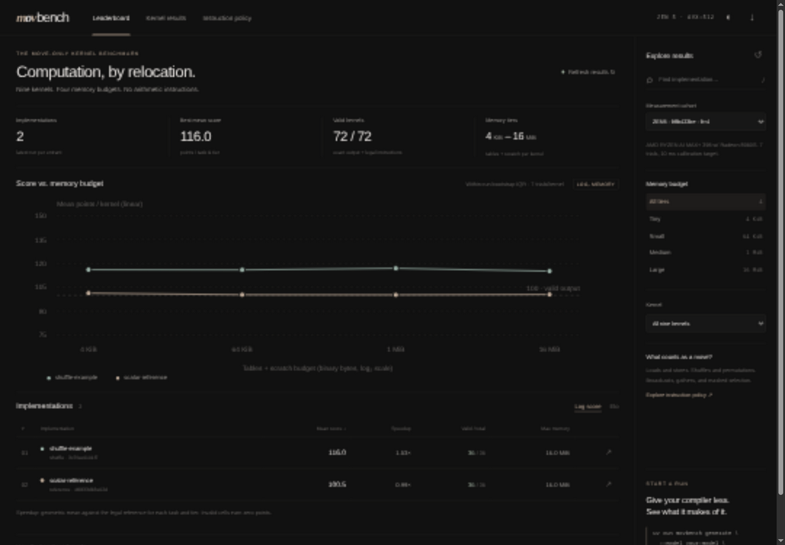

# MOVBench

**How much computation can an LLM squeeze out of instructions that only move data?**

MOVBench evaluates LLM-generated x86-64 assembly under explicit instruction and memory constraints. Kernels may load, store, shuffle, permute, broadcast, gather, scatter, and select existing bits. Arithmetic, comparisons, branches, calls, shifts, and submission-supplied returns are rejected. The default hardware target is **AMD Zen 5 with AVX-512**; Zen 4 is also selectable.

The benchmark includes nine exact integer kernels, four memory tiers, a scalar table/circuit reference compiler, a machine-code validator, a native timing worker, a compiler-command adapter, logarithmic scores, comparative Elo, and a local score dashboard inspired by [Slopalytics](https://slopalytics.com).



## Quick start

Linux x86-64, Python 3.11+, GCC, binutils (`objcopy`), and an AVX-512-capable AMD CPU are required for native runs. Viewing scores and generating submissions do not require AVX-512.

```bash
uv sync --extra dev
uv run movbench doctor
uv run movbench generate --backend reference --model scalar-reference --out submissions/reference
uv run movbench generate --backend shuffle --model shuffle-example --out submissions/shuffle
uv run movbench validate submissions/shuffle
uv run movbench run submissions/reference
uv run movbench run submissions/shuffle
uv run movbench scores
uv run movbench serve --port 8080
```

Open <http://127.0.0.1:8080>. Results are real measurements from your machine; the dashboard starts empty. `shuffle` uses AVX-512 VPERMB for routing and transpose and the basic reference compiler elsewhere. These examples are engineering baselines, **not LLM results**.

To inspect the checked-in Zen 5 example measurements without executing kernels:

```bash
uv run movbench import-run examples/results/*.json
uv run movbench serve
```

Imported runs retain their source hardware and cohort. Only import trusted result JSON; importing does not execute any submitted code.

For a short selected run, use `--tasks transpose_8x8,route_64 --tiers tiny`. Selected suites form their own cohort and cannot be mistaken for full-suite scores. A complete run covers **36 task/tier cells**. Missing, rejected, incorrect, faulting, or timed-out cells score zero and remain in the denominator.

## Memory tiers and kernels

| Tier | Tables + scratch budget |
|---|---:|
| tiny | 4 KiB |
| small | 64 KiB |
| medium | 1 MiB |
| large | 16 MiB |

All sizes use binary units (1 KiB = 1,024 bytes). The budget charges the complete `tables.bin` length plus the declared scratch allocation. Input and output sizes are fixed by each task and excluded. Machine code has a separate **1 MiB limit**. Data directives and accessing code as a lookup table are forbidden; instruction immediates are allowed and count toward the code cap. Native buffers are allocated once; allocation and compilation are outside timing.

| Task | Work per invocation |
|---|---|
| `add_u8`, `mul_u8`, `xor_u8` | 32 independent byte pairs, arithmetic modulo 256 |
| `madd_u8` | 32 fused `(a*b+c) mod 256` operations; input records are `(a,b,c,0)` |
| `sbox_u8` | 256 AES forward substitutions |
| `sum_u8` | 64-byte sum modulo 256 |
| `prefix_u8` | 64-byte inclusive scan modulo 256 |
| `transpose_8x8` | 64-byte matrix transpose |
| `route_64` | 64 runtime-indexed selections from 64 bytes |

The tiny reference synthesizes arithmetic from bit extraction and Boolean lookup tables, using **3,334 bytes of tables + 48 bytes scratch**. Larger tiers allow full 65,536-byte binary-operation lookup tables. Fused multiply-add uses Boolean circuits in tiny/small, two 64 KiB tables in medium, and a single 16 MiB three-input table in large. This exposes table fusion, dependency depth, and cache locality tradeoffs across every budget. Reference timing is specific to the task **and tier**.

## Submit assembly or connect a compiler

```bash
uv run movbench generate --out submissions/my-model --model my-model
```

This writes task JSON, a prompt with the ABI and policy, blank assembly bodies, table files, and a `submission.json`. Fill in `kernel.s`, `tables.bin`, and each manifest entry's `scratch_bytes`. Assembly uses Intel syntax, one instruction per line, with optional `#` comments. Do not add directives, labels, prologues, epilogues, or `ret`.

The fixed ABI is `rdi = input`, `rsi = output`, `rdx = read-only tables`, `rcx = scratch`. The writable scalar registers are `rax`, `r8`–`r11`, including their subregisters; vector registers and mask registers are available. Every memory operand must use one of the four buffer base registers. Index arithmetic implicit in x86 addressing is allowed, as in MOVfuscator; arithmetic instructions are not. Kernels are fixed-size straight-line programs, so iteration is unrolled at compile time. The trusted harness appends one return instruction. This is a kernel benchmark, not a general-purpose MOV-only control-flow runtime.

```bash
uv run movbench generate --model my-compiler --out submissions/my-compiler \
  --compiler-command 'python examples/compiler_adapter.py {spec} {output}'
```

The command is tokenized without a shell and invoked once per task/tier. Supported placeholders: `{spec}`, `{output}`, `{task}`, `{tier}`. It receives the same task specification and memory budget given to an LLM and writes `kernel.s`, `tables.bin`, and `kernel.json` containing `{"scratch_bytes": 0}`. Compilation failures are retained as invalid submissions. This adapter permits any LLM/API/tool workflow without hard-coding model providers or making paid API calls.

## Scoring and measurement

For each correct, legal, memory-compliant kernel:

```text
score = 100 + 25 × max(0, log₂(reference_median_ns / candidate_median_ns))
```

A valid output earns 100 points even if slower than reference. Each doubling of speed earns 25 additional points. Invalid cells earn zero. A run's score is the arithmetic mean over every requested cell. Speedup is dimensionless; durations are **wall nanoseconds per kernel invocation**.

The native worker verifies exact outputs, including all 65,536 operand pairs for the binary kernels, seeded random cases, boundary patterns, two execution histories, and post-timing rechecks. It pins itself to one logical CPU, warms and independently calibrates candidate/reference batch sizes, alternates measurement order, and retains seven trial observations by default. Each batch targets at least 10 ms during calibration. The measurement includes the input copy, function dispatch, and worker loop equally for both implementations. It cycles through 64 seeded fixtures; this is a warm-cache throughput workload, **not a cold-cache or production compiler benchmark**. Extremely fast kernels can approach the common copy/dispatch floor.

The median summarizes trial batch means; MAD is their median absolute deviation, not a confidence interval. Trial repetitions are in one process and are not independent machine sessions. Repeat complete runs to study session-to-session variability. Background load, power policy, and temperature can affect results.

The dashboard's error bars show the interquartile range of 400 deterministic bootstrap resamples of the paired candidate/reference batches within each kernel, aggregated across the selected kernels. They describe within-run variation, not session-to-session confidence. The plotted score itself uses the normative median-based formula above.

`movbench scores --mode elo` gives deterministic, descriptive pairwise Elo: 1,500 initial rating, 16 simultaneous-update rounds, K=16, a 3% timing draw band, valid beats invalid. It compares the latest complete run per model within one cohort. Elo is relative to entrants and is not interchangeable with logarithmic points.

Cohorts isolate CPU identity, target verification, microcode, OS/toolchain, selected suite, seed, affinity, measurement settings, policy, and harness version. Dashboard filters never blend incompatible cohorts. Each run retains native samples, input fixtures, source, tables, compiled code, hashes, commands, and errors under `runs/<id>/`; SQLite indexes completed runs in `.movbench/scores.sqlite3`. Re-running replaces a model's displayed result with its latest run while preserving earlier evidence.

## Instruction policy and execution boundary

[policy.json](src/movbench/policy.json) is the maintained, exact mnemonic whitelist. `movbench policy` prints it; the dashboard also displays it. See [the policy rationale](docs/instruction-policy.md).

Validation decodes the entire assembled body, rejects forbidden opcodes and register writes, checks every memory operand, and validates the harness return. Inputs/tables are read-only during correctness checks, code is write-then-execute, buffers end at guard pages, and writable leading padding is checked for corruption. Faults and timeouts are recorded. Native execution happens in a subprocess with resource limits.

**This worker is not a security sandbox.** Static checks and guard pages are for benchmark integrity and accidental bugs; they do not prove all memory accesses in every unseen input remain in bounds. Run externally sourced submissions in a disposable VM/container with no secrets or network. The local server is read-only and never runs uploaded code.

## Development

```bash
uv run pytest
uv run ruff check .
uv build
```

Native integration tests require Linux x86-64; vector execution tests skip on unsupported hardware. CI exercises the scalar worker plus instruction-validation and scoring regressions. Add a task by versioning its specification, oracle, adversarial fixture coverage, and legal reference implementation together.

Background: [M/o/Vfuscator](https://github.com/xoreaxeaxeax/movfuscator), [Intel instruction reference](https://www.intel.com/content/www/us/en/developer/articles/technical/intel-sdm.html), and [AMD's AVX-512 discussion](https://www.amd.com/en/blogs/2026/understanding-avx-512---validating-usage-on-amd-epyc-.html). The instruction subset is intentionally a data-movement extension of MOV-only computation, allowing AVX-512 shuffles and permutations.
